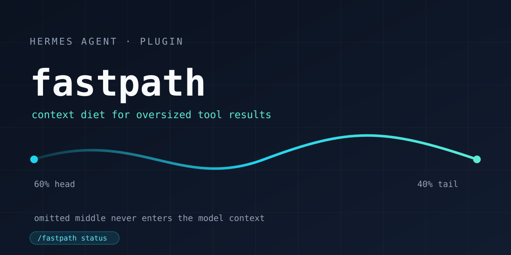
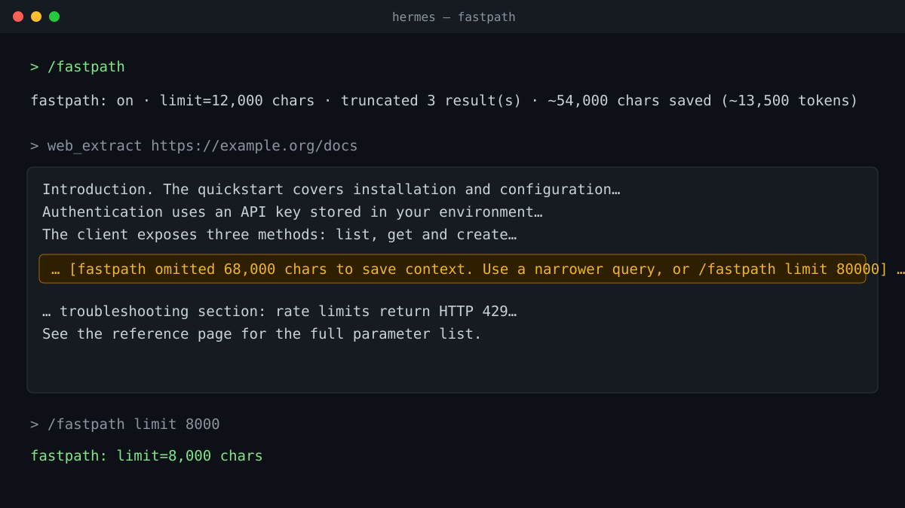

# fastpath

Context-diet plugin for Hermes Agent. It compresses oversized tool results
before they enter the model context, reducing token use, latency and cost.



## Install

1. Download `fastpath-plugin-1.0.0.zip` from the v1.0.0 release and extract it.
2. Copy the `fastpath` folder into `<HERMES_HOME>/plugins/`
   (for example `~/.hermes/plugins/fastpath/`).
3. Add `fastpath` to `plugins.enabled` in `<HERMES_HOME>/config.yaml`:

   ```yaml
   plugins:
     enabled:
       - fastpath
   ```

4. Restart the gateway, then run `/fastpath` to confirm the plugin is active.

Requires Hermes >= 0.23.

## What it does

- Registers `transform_tool_result`: any string tool result longer than the
  configured limit is replaced by its first 60% + last 40%, with an explicit
  omission marker so the model knows content was skipped.
- Registers `pre_llm_call` as a no-op extension point (stable manifest).
- Adds `/fastpath` slash command.

## Commands

| Command | Effect |
|---|---|
| `/fastpath` | status + savings |
| `/fastpath on` / `off` | enable/disable compression |
| `/fastpath limit 8000` | set max kept characters (default 12000) |
| `/fastpath reset` | reset counters |

State lives at `~/.hermes/fastpath/state.json` (respects `HERMES_HOME`).

## Safety

- Never modifies the original tool output on disk; only replaces what is
  handed to the model for that turn.
- Skips non-string results and anything under the limit.
- Errors are logged and degradation is fail-open: a broken hook leaves the
  result unchanged.

## Testing

The plugin has a stdlib-only functional test suite (no dependencies):

```bash
python -m unittest discover -s tests -v
```

It covers hook registration, compression head/tail and omission marker,
counter persistence, on/off and limit handling, corrupt state recovery,
ratio clamping, fail-open behaviour and every `/fastpath` command. It also
runs automatically on every push via GitHub Actions.

## Size benchmark

Run `python benchmark.py` for a reproducible table of characters kept and
omitted at the default limit; results and interpretation are in
[docs/benchmark.md](docs/benchmark.md). At 12,000 chars kept, an 80,000-char
file read sends ~85% fewer characters to the model.

## Screenshots



## Author

Siavash Mirtaheri (BlackVash) — 2026. MIT license.
